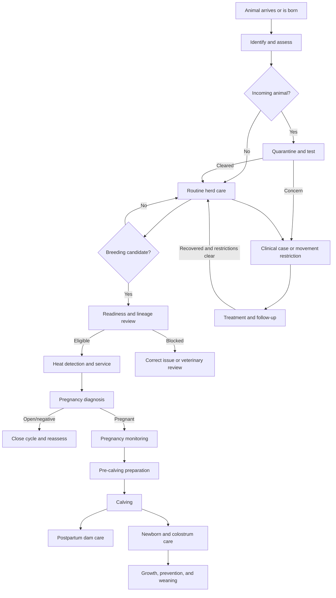

# Cattle Farm Practice Rules

> Working policy for HerdSync workflows. Baseline: breeding-focused cattle operation in the Philippines. Farm veterinarian must approve vaccination, treatment, withdrawal, emergency, and disease-control protocols. Product labels and current government rules override this document.

## Purpose

HerdSync should help staff make safe farm decisions, not only store records. Each workflow should answer:

1. Is animal eligible for action?
2. What must be checked first?
3. What blocks action?
4. What follow-up becomes due?
5. When must case be escalated?
6. What evidence must be recorded?

---

## 1. Roles and decision authority

### Farm aide

- Observe animals and record factual findings.
- Record weights, heat signs, feeding, routine care, and completed procedures.
- Follow approved protocols only.
- Cannot diagnose disease, prescribe medicine, change withdrawal periods, or independently resolve serious cases.
- Escalate abnormal findings to veterinarian or farm manager.

### Veterinarian

- Diagnose illness and reproductive problems.
- Approve treatment, medicine, dosage, route, duration, and withdrawal period.
- Decide breeding fitness for borderline animals.
- Confirm pregnancy, pregnancy loss, difficult-calving response, recovery, isolation release, and return to breeding.
- Approve herd health, vaccination, parasite-control, and biosecurity programs.

### Farm manager or authorized faculty

- Approve purchasing, sale, culling, transfer, breeding season, stocking, and production targets.
- Review overdue care, mortality, reproductive performance, and medicine compliance.
- Cannot override veterinary restrictions for convenience.

### System principle

- Staff may record observation without claiming diagnosis.
- High-risk or irreversible actions require identified responsible person.
- Records must preserve who, what, when, animal, product, dose, route, reason, and outcome.

---

## 2. Animal onboarding and intake

### Before arrival

Record:

- Source farm, seller/donor, contact, address, and transport details.
- Official or farm identification.
- Sex, estimated or documented age, breed, and intended use.
- Vaccination, deworming, treatment, reproductive, and disease history.
- Pregnancy claim and supporting examination record.
- Known exposure to infectious disease.

### Arrival checks

Every incoming animal needs:

- Identity verification and readable tag.
- Arrival date and source.
- Visual examination before mixing with herd.
- Temperature when illness or transport stress is suspected.
- Weight or weight estimate.
- Body condition score using one farm-approved scale consistently.
- Appetite, hydration, manure, respiration, gait, skin, eyes, nose, udder/testes, and injury check.
- Pregnancy/reproductive status when relevant.
- Transport injuries and immediate welfare needs recorded.

### Quarantine

- New or returning cattle remain physically separated under farm biosecurity policy.
- Use separate equipment or clean/disinfect shared equipment between groups.
- Handle resident herd before quarantine group when practical.
- Restrict nose-to-nose contact and shared water/feed sources.
- Observe daily for appetite, fever, cough, nasal discharge, diarrhea, skin lesions, lameness, and abnormal behavior.
- Veterinarian defines quarantine duration and required tests based on source risk and current disease conditions.
- Do not release solely because fixed number of days elapsed.

### Intake restrictions

Block normal herd entry when:

- Identity or ownership is uncertain.
- Required source records are missing.
- Animal shows infectious-disease signs.
- Animal has unresolved treatment or withdrawal status.
- Pregnancy or breeding status conflicts with intended use.
- Animal has serious injury, severe lameness, poor body condition, or transport stress requiring care.
- Veterinarian-required testing is incomplete.

### Release from quarantine

Release requires:

- No unresolved infectious signs.
- Required tests reviewed.
- Preventive care plan completed or scheduled.
- Treatment and withdrawal status known.
- Veterinarian or designated authority approval recorded.

### Farm-born calf onboarding

Record immediately or as soon as safely possible:

- Dam, known sire/service, birth date/time, birth order, sex, and birth type.
- Birth outcome: live, stillborn, or neonatal death.
- Birth weight or reason unavailable.
- Calving difficulty and assistance.
- Calf vigor, breathing, standing, suckling, and abnormalities.
- Colostrum timing and method.
- Permanent farm ID according to farm policy.

---

## 3. Identification and record integrity

- One animal must have one permanent internal record.
- Tag replacement must preserve old identifier as alias/history.
- Never reuse identifier belonging to another animal.
- Unknown values remain unknown; do not invent dates, pedigree, weight, diagnosis, or treatment.
- Estimated values must be marked estimated and include method/source.
- Correction should preserve audit trail rather than silently erase clinical or reproductive history.
- Archive/transfer/death must not delete historical records.
- Duplicate-animal check should compare tag, source ID, sex, birth date, markings, and pedigree.

---

## 4. Daily observation and welfare

Observe herd at least according to farm routine, with higher frequency for quarantine, sick, pregnant-near-calving, newborn, and recently treated animals.

### Record or escalate

- Off feed or reduced rumination.
- Isolation from herd or abnormal behavior.
- Respiratory distress, persistent cough, or nasal discharge.
- Diarrhea, bloat, dehydration, or abnormal manure.
- Lameness, inability to rise, injury, or swelling.
- Abnormal vaginal discharge, abortion, retained placenta, or difficult labor.
- Udder heat/swelling, abnormal milk, or calf unable to nurse.
- Sudden weight/BCS loss.
- Neurologic signs, collapse, severe bleeding, or severe pain.

### Emergency flags

System should mark urgent and direct immediate human escalation for:

- Breathing difficulty.
- Recumbency or inability to stand.
- Severe bleeding or trauma.
- Suspected bloat with distress.
- Prolapse.
- Seizure or neurologic signs.
- Suspected poisoning.
- Difficult labor with no progress.
- Newborn not breathing or severely weak.
- Sudden death or multiple animals with similar acute signs.

Software must not replace emergency veterinary contact.

---

## 5. Breeding readiness

Age alone does not make animal breeding-ready.

### Dam or heifer readiness

Confirm:

- Correct identity and active ownership/status.
- Female is not pregnant.
- No unresolved breeding service awaiting outcome.
- Pubertal maturity and adequate growth for breed/type.
- Target weight or frame maturity defined by farm; avoid relying only on fixed age.
- Acceptable body condition for breeding under farm scale.
- No unresolved clinical illness, significant lameness, reproductive infection, abnormal discharge, or active withdrawal concern.
- Reproductive tract/fitness examination when required by veterinarian.
- Vaccination and parasite-control plan reviewed before breeding season.
- Postpartum dam has recovered and meets veterinarian/farm voluntary waiting policy.
- Previous calving complications and reproductive history reviewed.

### Hard breeding blocks

Do not select dam when:

- Currently pregnant.
- Existing service has no recorded outcome and remains active.
- Active illness, fever, significant lameness, severe poor condition, or unresolved reproductive disorder exists.
- Under active treatment when breeding is contraindicated.
- Postpartum recovery has not been cleared.
- Age/weight/maturity target is not met.
- Required breeding soundness assessment is failed or incomplete.
- Known pedigree pairing violates farm inbreeding policy.

### Sire readiness

Confirm:

- Correct identity and active status.
- Breeding soundness examination is current when required.
- Adequate feet, legs, vision, libido, and body condition.
- Testes/reproductive health acceptable.
- No active infectious or venereal-disease concern.
- Vaccination and parasite-control plan current.
- Sire-to-female ratio and workload appropriate for terrain, age, and breeding season.
- Pedigree/genetic defects and mating compatibility reviewed.

### Sire restrictions

- No self, parent-offspring, full-sibling, or other pairing above farm inbreeding threshold.
- Unknown pedigree should be shown as unknown risk, not automatically safe.
- Do not use sire with failed/expired required breeding soundness status.
- Do not use injured, severely lame, sick, or reproductively suspect sire.

---

## 6. Heat detection and breeding service

### Heat observation

Record actual signs, not only “in heat”:

- Standing to be mounted.
- Mounting activity.
- Clear mucus.
- Restlessness/increased activity.
- Swollen vulva.
- Chin resting, rubbed tail head, or other secondary signs.
- Observer, date, time, confidence, and detection method.

### Heat logic

- Standing heat is stronger evidence than secondary signs alone.
- Repeated observations from multiple times improve confidence.
- Do not create duplicate heat events from same observed episode.
- Irregular, absent, or repeated heat should trigger reproductive review according to farm thresholds.
- Heat in an animal believed pregnant requires veterinary review, not immediate rebreeding.

### Natural service record

Record:

- Dam and sire.
- Service date and observed/assumed mating.
- Pasture/pen or breeding group.
- Handler/observer.
- Any injury, refusal, repeated service, or uncertain mating.

### Artificial insemination record

Record:

- Dam and insemination date/time.
- Heat onset/observation time when known.
- Technician.
- Semen sire identity/code, breed, supplier, batch/lot, and straw ID.
- Semen type.
- Thaw temperature/time and insemination site when part of farm protocol.
- Procedure difficulty or abnormal findings.

### Repeat-service logic

- Existing service stays active until outcome: pregnant, negative/open, loss, or other approved closure.
- Do not start overlapping service cycle without closing or medically reviewing prior cycle.
- Return to heat after service should link to prior service and trigger repeat-breeder monitoring.
- Farm must define escalation threshold for repeated failed services; veterinarian reviews before unlimited repeats.
- System should show services per conception, days open, and repeat-breeder flags.

---

## 7. Pregnancy diagnosis and management

### Diagnosis

- Pregnancy status must identify method, examiner, examination date, and linked service.
- Method may include palpation, ultrasound, laboratory test, or veterinarian-approved method.
- Do not treat absence of observed heat as confirmed pregnancy.
- Early diagnosis may require scheduled recheck.
- Negative result closes current pregnancy attempt but should preserve service history.

### Active pregnancy

- One dam should have only one active pregnancy episode.
- Pregnancy links to service/sire when known.
- Expected calving date derives from service date and breed/farm gestation assumption; it is an estimate, not guaranteed date.
- Correcting conception/service date should recalculate expected dates with audit trail.

### Routine pregnancy monitoring

Track based on farm/veterinarian schedule:

- Weight and body condition trend.
- Appetite, manure, mobility, and general health.
- Fetal/pregnancy status when recheck indicated.
- Vaccination and parasite plan safe for gestational stage.
- Nutrition group and mineral access.
- Abnormal discharge, bleeding, premature udder development, pain, or signs of abortion.
- Expected calving window and movement to observation/calving area.

### High-risk pregnancy flags

- Previous dystocia, prolapse, retained placenta, abortion, stillbirth, or neonatal loss.
- Heifer or small-framed dam bred to high birth-weight-risk sire.
- Twins or suspected multiple pregnancy.
- Poor or excessive body condition.
- Lameness, chronic disease, or significant weight loss.
- Pregnancy beyond expected window.
- Abnormal discharge, fever, reduced intake, or suspected fetal loss.

High-risk status increases observation and requires explicit calving plan.

### Pregnancy loss

Record:

- Date detected and estimated loss date if different.
- Gestational stage.
- Clinical signs and disposition of fetus/placenta.
- Samples submitted and laboratory results.
- Isolation/biosecurity actions.
- Veterinarian assessment and likely/confirmed cause.
- Dam treatment, withdrawal, follow-up, and return-to-breeding decision.

Abortion clusters or potentially reportable disease signs require immediate veterinary and regulatory response.

---

## 8. Pre-calving preparation

Before expected calving window:

- Confirm dam identity, pregnancy, expected date, parity, prior calving history, and risk flags.
- Check calving area for cleanliness, dryness, footing, lighting, restraint access, and low stress.
- Prepare clean assistance equipment and newborn supplies.
- Confirm responsible staff and emergency veterinarian contact.
- Increase observation frequency without causing unnecessary disturbance.
- Record udder development, pelvic relaxation, discharge, behavior, and labor signs.

### Labor stages and escalation

Farm veterinarian must define exact intervention thresholds. System should capture:

- Time labor signs first observed.
- Time water bag/active labor observed.
- Presentation when visible.
- Progress checks.
- Assistance start, reason, people involved, and method.

Escalate when:

- No progress within veterinarian-approved interval.
- Abnormal presentation is suspected.
- Excessive bleeding, prolapse, exhaustion, severe distress, or foul discharge occurs.
- Calf appears too large or traction is unsafe.
- Staff lack training/equipment for correction.

Never encode aggressive extraction as default. Excessive or incorrectly directed traction can injure dam and calf.

---

## 9. Calving and newborn care

### Calving record

Record:

- Dam, linked pregnancy/service, date/time, location, and attendant.
- Birth type and birth order.
- Unassisted/assisted status and difficulty.
- Presentation and assistance details.
- Placenta status and maternal complications.
- Each calf’s sex, outcome, weight, vigor, abnormalities, and ID.

### Immediate newborn priorities

1. Ensure airway and breathing.
2. Protect from cold/heat and unsafe environment.
3. Assess vigor and ability to stand/suckle.
4. Ensure timely intake of adequate high-quality colostrum under farm/veterinarian protocol.
5. Treat navel using approved protocol.
6. Confirm dam-calf bonding and milk access.
7. Record interventions and responsible person.

Weak calf, poor suckle, hypothermia/heat stress, difficult birth, prematurity, abnormality, or failure to stand requires urgent assessment and closer follow-up.

### Colostrum logic

- Record first intake time, source, method, and approximate amount when managed.
- “Calf with dam” does not prove adequate intake.
- Delayed or uncertain intake should generate alert and veterinarian/farm protocol action.
- Stored colostrum must be traceable and handled hygienically.

### Dam postpartum checks

Monitor:

- Standing, appetite, hydration, pain, and injuries.
- Bleeding and discharge.
- Udder, teat patency, and milk availability.
- Placenta passage according to veterinary protocol; do not manually remove without direction.
- Fever, foul discharge, depression, reduced intake, or prolapse.
- Calf acceptance and nursing.

### Outcome handling

- Live calf receives livestock record and care schedule.
- Stillbirth remains linked outcome even without active livestock record.
- Neonatal death needs calf identity, survival interval, signs, treatment, cause if known, and carcass disposition.
- Mortality should not be recorded as generic deletion.

---

## 10. Calf-rearing logic

### Early-life monitoring

Track:

- Nursing/feeding success.
- Temperature when illness suspected.
- Diarrhea, dehydration, respiratory signs, navel infection, joint swelling, weakness, and weight gain.
- Dam milk supply and maternal behavior.
- Treatments and withdrawal implications.

### Growth and care

- Use farm-defined weighing schedule and growth targets by breed/system.
- Missed growth target triggers nutrition, disease, parasite, and milk-supply review.
- Vaccination, castration, dehorning/disbudding, identification, and parasite procedures require approved timing, pain control, trained personnel, and records.
- Do not use one fixed schedule for every farm without veterinary approval.

### Weaning

Weaning decision should consider:

- Age and weight target.
- Health and recent stress.
- Feed/water adaptation.
- Weather, transport, vaccination, and other procedures.
- Avoid stacking multiple major stressors when practical.
- Record date, method, weight, group, and post-weaning observation.

---

## 11. Health-case workflow

### Observation versus diagnosis

- Aide records signs: “coughing, temperature 40.2°C, off feed.”
- Veterinarian records diagnosis: “bovine respiratory disease,” when supported.
- Unknown diagnosis remains “under assessment.”

### Clinical case record

Capture:

- Animal, onset/detection date, signs, severity, and measurements.
- Isolation status.
- Diagnosis or differential diagnosis and veterinarian.
- Tests/samples and results.
- Treatment plan and supportive care.
- Follow-up date and response.
- Resolution, chronic status, relapse, culling, or death.

### Isolation rules

- Suspected contagious cases should be separated based on veterinary protocol.
- Isolation must have reason, start date, location, handling precautions, and release criteria.
- Release requires clinical review, not only elapsed time.
- Shared equipment and staff movement need cleaning/biosecurity controls.

### Follow-up logic

- Open clinical case cannot be silently marked resolved.
- Follow-up records current signs, objective measurements, response, adverse effects, and plan.
- “Recovered” requires defined clinical criteria.
- “Monitoring” requires next review date based on case severity, not universal fixed interval.
- Worsening/no response triggers veterinarian reassessment, not automatic repeat medication.

---

## 12. Medicines, treatments, and withdrawal

### Before administration

Verify:

- Correct animal and weight basis.
- Diagnosis/indication and authorized prescriber where required.
- Product, concentration, dose, route, site, frequency, duration, and storage.
- Expiry date and batch/lot.
- Contraindications including pregnancy, age, and concurrent medicines.
- Meat/milk withdrawal requirements.
- Previous treatment and adverse reactions.

### Administration record

Record immediately:

- Product and active ingredient where available.
- Dose and unit.
- Route and injection site.
- Date/time.
- Administrator.
- Batch/lot and expiry where required.
- Start/end dates for course.
- Withdrawal end date calculated from final administration.
- Missed, spilled, partial, or repeated dose.

### Restrictions

- Do not permit vague dose without unit.
- Do not permit treatment closure before prescribed course/follow-up unless veterinarian changes plan.
- Do not permit sale, slaughter, or milk release before withdrawal completion.
- Changing dose, route, duration, or withdrawal requires authorized review.
- Re-treatment without response assessment should be flagged.
- Antimicrobial use should follow veterinary oversight and stewardship policy.

### Inventory and traceability

- Track received, used, wasted, expired, and remaining quantities where medicine inventory is managed.
- Quarantine expired/damaged products from use.
- Preserve batch traceability for recall.
- Record disposal according to product and regulatory requirements.

---

## 13. Vaccination and parasite control

- Veterinarian defines farm-specific program from disease risk, age, production type, region, product labels, and government requirements.
- Record vaccine/product, target disease, dose, route, site, batch, expiry, administrator, and next due date.
- Maintain required cold chain and record breach.
- Sick, stressed, recently transported, pregnant, or young animals may require modified timing/product choice.
- Missed dose does not automatically mean restart; follow veterinarian/product guidance.
- Parasite treatment should consider risk, clinical signs, fecal testing where appropriate, season, grazing, resistance, and prior product use.
- Avoid automatic calendar treatment without herd strategy.

---

## 14. Biosecurity and outbreak logic

### Routine controls

- Visitor and vehicle access policy.
- Clean footwear/clothing and equipment where required.
- Quarantine incoming/returning animals.
- Isolate suspect cases.
- Control shared needles and treatment equipment.
- Manage carcasses, manure, bedding, feed, water, pests, and wildlife exposure.
- Keep source and movement records.

### Outbreak trigger

Potential outbreak when multiple animals show linked signs, unusual mortality, abortions, sudden production decline, or known exposure.

System should:

- Group affected animals by location/contact/time.
- Mark suspect/confirmed case status.
- Record movement restrictions and isolation.
- Notify veterinarian/management.
- Track tests, contacts, treatments, outcomes, and release criteria.
- Preserve timeline for regulatory reporting.

---

## 15. Movement, sale, culling, death, and carcass disposition

### Movement or sale

Before release confirm:

- Identity and ownership.
- Health and movement documentation.
- No active isolation or movement restriction.
- Withdrawal period complete.
- Pregnancy status disclosed where relevant.
- Destination, transporter, date, and reason recorded.

### Culling decision

Record reason categories such as:

- Reproductive failure.
- Chronic disease or lameness.
- Poor performance.
- Temperament/safety.
- Genetic defect.
- Age.
- Herd planning.

Culling must not bypass welfare treatment, withdrawal, or fitness-for-transport rules.

### Death

Record:

- Date/time found or euthanized.
- Last known normal observation.
- Signs/events before death.
- Suspected/confirmed cause and veterinarian involvement.
- Necropsy/samples.
- Medicines and withdrawal status.
- Carcass disposition.
- Related cases or outbreak concern.

---

## 16. Alerts and workflow priorities

### Critical

- Emergency welfare signs.
- Difficult labor/no progress.
- Suspected contagious outbreak.
- Abortion cluster.
- Withdrawal violation risk.
- Overdue urgent follow-up.

### High

- Sick newborn or uncertain colostrum.
- High-risk pregnancy near calving.
- Treatment not improving.
- Pregnant animal proposed for breeding.
- Active breeding cycle proposed for duplicate service.
- Missing medicine dose/route/unit.

### Routine

- Upcoming pregnancy recheck.
- Vaccination/parasite review.
- Weight/BCS review.
- Weaning assessment.
- Postpartum and newborn care tasks.

Alerts need owner, due date, status, completion evidence, and escalation path. Dismissal alone must not equal completion.

---

## 17. Rules HerdSync should enforce

### Hard blocks

- Duplicate animal identity.
- Future event date for completed activity.
- Breeding pregnant dam.
- Overlapping unresolved breeding service.
- Natural service without sire.
- Known prohibited lineage pairing.
- Calving without active pregnancy, except authorized correction workflow.
- Medicine administration without product, dose/unit, route, animal, date, and administrator.
- Movement/sale/slaughter during active withdrawal or movement restriction.
- Direct closure of unresolved serious clinical case without follow-up.

### Warnings requiring confirmation or approval

- Unknown pedigree pairing.
- Borderline BCS/weight/age.
- Repeated failed services.
- Pregnancy beyond expected date.
- Missing colostrum evidence.
- Treatment outside expected protocol.
- Significant weight loss.
- Overdue vaccine, checkup, or care task.

### Automatic logic

- Calculate expected pregnancy and calving windows, but show as estimates.
- Create pregnancy-check task after service.
- Remove dam from breeding choices while service/pregnancy active.
- Create pre-calving monitoring task.
- Create postpartum dam and newborn tasks after calving.
- Calculate withdrawal from final treatment, not first dose.
- Keep animal restricted until withdrawal and clinical/movement restrictions both clear.
- Carry unresolved risks forward between pages and workflows.
- Preserve audit trail for corrections.

---

## 18. Farm decisions still needing approval

These values must be configured from actual farm and veterinarian policy rather than guessed:

- Operation type: breeding beef, dairy, or mixed.
- Approved BCS scale and target ranges.
- Heifer target age, weight, and frame maturity.
- Postpartum voluntary waiting period.
- Breeding season dates and sire-to-female ratio.
- Repeat-service escalation threshold.
- Pregnancy diagnosis method and recheck schedule.
- Checkup frequency by gestational risk.
- Labor intervention thresholds.
- Colostrum timing, quality, and quantity protocol.
- Newborn procedure schedule.
- Vaccination and parasite-control program.
- Case-specific follow-up intervals.
- Quarantine duration, tests, and release criteria.
- Isolation and outbreak protocols.
- Weaning targets and method.
- Medicine authorization and inventory controls.
- Local regulatory records and reporting requirements.

---

## 19. Practical lifecycle

## Review standard

Every proposed HerdSync rule should be classified as:

- **Farm policy:** manager-approved operating choice.
- **Veterinary protocol:** clinician-approved health/reproduction rule.
- **Legal/regulatory requirement:** cannot be overridden locally.
- **Product-label rule:** product-specific dose, route, storage, and withdrawal.
- **Software convenience:** may guide workflow but must not be presented as biological certainty.
