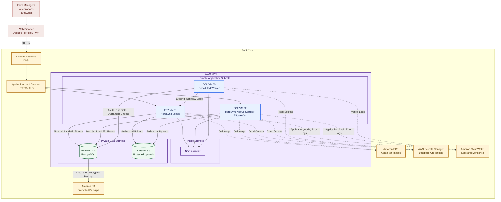
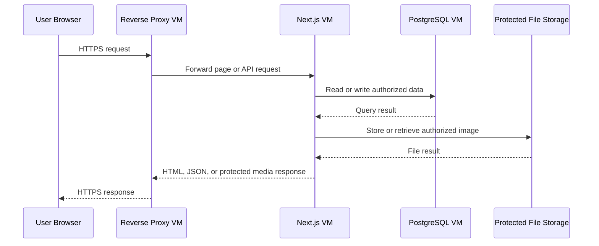

```

## VM responsibilities

- **VM-01 — Edge:** Terminates HTTPS and forwards browser traffic to the application VM.
- **VM-02 — Application:** Runs the existing Next.js application, API routes, authentication, cattle workflows, breeding, pregnancy, calving, health, reports, alerts, and uploads.
- **VM-03 — Database:** Runs PostgreSQL. Keep database access private; do not expose PostgreSQL directly to users.
- **Operations host:** Runs deployment commands, database migrations, monitoring, and log collection.

## Logic-preservation rules

1. Keep current Next.js App Router and API route boundaries.
2. Keep authentication and role checks inside existing application logic.
3. Keep PostgreSQL schema, migrations, transactions, and audit records unchanged.
4. Keep uploads behind application authorization; do not expose upload directories as unrestricted public storage.
5. Run scheduled alerts, pregnancy checks, treatment follow-ups, withdrawal checks, and quarantine checks through the existing workflow rules.
6. Run database migrations before starting a new application version.
7. Use private VM networking between application and database tiers.
8. Back up PostgreSQL separately from application files.
9. Use HTTPS at the reverse proxy and forward only required headers to Next.js.
10. Use process supervision such as systemd, Windows service hosting, or a supported Node.js process manager to restart the application after failure.

## Request flow


